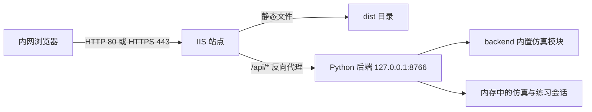

# 故障注入平台 Windows 正式部署操作手册

## 1. 文档说明

本文档用于将当前故障注入平台部署到一台新的 Windows 机器，并作为内网正式服务长期运行。目标环境以 Windows Server 为主，Windows 10/11 可按同样结构用于小规模内网部署。

本文档对应当前工程：

- 前端：Vue 3 + Vite，生产产物位于 `dist/`。
- 后端：Python 标准库 HTTP 服务，入口为 `python -m backend.server`。
- 后端默认监听：`127.0.0.1:8766`。
- 前端 API：使用 `/api/...` 相对当前站点根路径访问。
- 正式部署入口：IIS 提供静态文件，并将 `/api/*` 反向代理到后端。

> 重要：`serve-dist-local.mjs` 只提供静态文件，不代理 `/api`。它适合本地预览，不能直接作为完整的正式部署入口。Vite 开发服务器虽然配置了 API 代理，也不应作为生产服务长期运行。

## 2. 推荐部署架构



该架构有以下特点：

- 浏览器只访问 IIS，不直接访问 8766 端口。
- 前后端保持同源，不需要修改当前前端的 API 相对路径，也不引入跨域配置。
- Python 后端由 Windows 服务管理，可开机自启、失败重启并集中记录日志。
- 后端会话保存在内存中。重启后端服务会终止尚未完成的仿真和练习会话，因此升级应安排维护窗口。
- 当前后端是单进程服务，不应直接启动多个实例共享流量；不同进程不会共享会话状态。

## 3. 部署前检查

### 3.1 机器和网络建议

以下为一般性起点，最终规格应以模型规模、并发人数和压测结果为准：

| 项目 | 建议 |
| --- | --- |
| CPU | 4 核或以上 |
| 内存 | 8 GB 或以上 |
| 可用磁盘 | 20 GB 或以上，日志和备份单独预留空间 |
| 网络 | 固定内网 IP；正式使用时配置内网 DNS 名称 |
| 时间 | 与单位统一时间源同步 |
| 权限 | 安装阶段需要本机管理员；运行阶段使用低权限服务账号 |

### 3.2 软件清单

| 软件 | 用途 | 是否必须安装在目标机 |
| --- | --- | --- |
| IIS | 静态站点和 API 反向代理 | 是 |
| IIS URL Rewrite | URL 重写规则 | 是 |
| IIS Application Request Routing（ARR） | 反向代理 | 是 |
| Python 3 | 运行 `backend.server` | 是 |
| WinSW | 将 Python 后端包装为 Windows 服务 | 是，或使用单位批准的等价服务包装器 |
| Node.js 20+ / npm 10+ | 安装依赖并构建前端 | 只在构建机需要；若目标机不构建则不需要 |

当前后端运行代码只使用 Python 标准库和工程内模块，不需要安装第三方 Python 包。运行测试时可使用项目现有的 `uv` 命令，也可使用已安装的 Python。

### 3.3 端口规划

| 端口 | 监听方 | 对外开放 | 说明 |
| ---: | --- | --- | --- |
| 80 | IIS | 按现场策略 | HTTP；可只用于跳转 HTTPS |
| 443 | IIS | 推荐 | HTTPS 正式入口 |
| 8766 | Python 后端 | 否 | 只监听 `127.0.0.1`，由 IIS 访问 |

不要为 8766 创建入站放行规则。若发现其他机器可以直接访问 8766，应立即检查后端监听地址和防火墙配置。

## 4. 目录和版本规划

本文档使用以下示例目录：

```text
C:\FaultInjectionPlatform\
├─ releases\
│  └─ 20260717-001\
│     ├─ dist\
│     └─ backend\
├─ current                 # 指向当前版本目录的 NTFS Junction
├─ venv\                   # Python 虚拟环境，独立于业务版本
├─ service\                # WinSW 可执行文件和 XML
├─ logs\
│  ├─ backend\
│  └─ deployment\
└─ packages\               # 接收到的发布压缩包
```

原则：

- 每个版本使用独立目录，名称必须唯一。
- `current` 始终指向正在运行的版本，IIS 和后端服务只引用 `current`。
- 不在运行中的版本目录内直接覆盖文件。
- 虚拟环境、服务包装器和日志不随业务版本切换。

## 5. 在构建机制作发布包

### 5.1 获取并确认代码版本

在工程目录执行：

```powershell
Set-Location 'D:\项目方案\故障注入'
git status --short
git rev-parse HEAD
```

发布记录中保存提交号。若工作区存在未确认修改，不应直接制作正式发布包。

### 5.2 安装前端依赖并验证

Windows PowerShell 可能优先调用受执行策略限制的 `npm.ps1`，因此以下命令明确使用 `npm.cmd`：

```powershell
npm.cmd ci
npm.cmd test -- --run
uv run python -m unittest discover backend.tests -v
npm.cmd run audit:ui
```

所有发布门禁通过后再构建。若机器未安装 `uv`，但已安装 Python，可将后端测试命令改为：

```powershell
python -m unittest discover backend.tests -v
```

### 5.3 构建前端

```powershell
npm.cmd run build
```

确认以下文件存在：

```powershell
Test-Path '.\dist\index.html'
Get-ChildItem '.\dist\assets' | Select-Object -First 5
Test-Path '.\dist\model-packages\evtol-small-flight-control-fault-display.json'
```

三项检查均应返回有效结果。Vite 会把 `public/` 中的模型包和示例资源复制到 `dist/`。

### 5.4 整理发布目录

以下示例使用版本号 `20260717-001`：

```powershell
$Version = '20260717-001'
$StageRoot = "D:\FaultInjectionRelease\$Version"

New-Item -ItemType Directory -Path $StageRoot -Force | Out-Null
Copy-Item -LiteralPath '.\dist' -Destination $StageRoot -Recurse
Copy-Item -LiteralPath '.\backend' -Destination $StageRoot -Recurse
Copy-Item -LiteralPath '.\README.md' -Destination $StageRoot
```

把第 9.1 节已经验收的 `web.config` 放入 `$StageRoot\dist\web.config`，再生成校验值和压缩包。这样每个版本都带有与前端一起验证过的 IIS 规则，升级切换后不会丢失 API 代理。首次部署可先按第 9.1 节在目标机创建，验收后将同一文件纳入后续发布包。

后端必须完整包含以下内容：

- `backend/server.py`
- `backend/module_registry.py`
- `backend/builtin_modules/manifest.json`
- `backend/builtin_modules/*.py`
- 其余 `backend/*.py`

如果新增了后端仿真组件，组件 `.py` 和 `manifest.json` 必须在同一个发布版本中一起交付。

### 5.5 生成校验值和压缩包

```powershell
$Version = '20260717-001'
$StageRoot = "D:\FaultInjectionRelease\$Version"
$ZipPath = "D:\FaultInjectionRelease\fault-platform-$Version.zip"

Get-ChildItem $StageRoot -Recurse -File |
  Get-FileHash -Algorithm SHA256 |
  ForEach-Object { "$($_.Hash)  $($_.Path.Substring($StageRoot.Length + 1))" } |
  Set-Content -Encoding UTF8 "$StageRoot\SHA256SUMS.txt"

Compress-Archive -Path "$StageRoot\*" -DestinationPath $ZipPath -Force
Get-FileHash -Algorithm SHA256 $ZipPath
```

将压缩包 SHA-256、Git 提交号、构建时间和构建人写入发布记录。

## 6. 准备目标 Windows 服务器

### 6.1 安装 IIS

在管理员 PowerShell 中执行：

```powershell
Install-WindowsFeature Web-Server -IncludeManagementTools
```

该命令适用于 Windows Server。微软文档说明 `Install-WindowsFeature` 需要管理员权限，且管理工具需要通过 `-IncludeManagementTools` 显式安装。

Windows 10/11 可通过“启用或关闭 Windows 功能”安装“Internet Information Services”，至少启用：

- Web 管理工具
- 万维网服务
- 常见 HTTP 功能中的默认文档、静态内容和 HTTP 错误
- 运行状况和诊断中的 HTTP 日志记录、请求监视器

### 6.2 安装 URL Rewrite 和 ARR

从单位批准的软件源安装 IIS URL Rewrite 和 Application Request Routing。安装后在 IIS 管理器中：

1. 选中服务器节点。
2. 打开“Application Request Routing Cache”。
3. 点击“Server Proxy Settings”。
4. 勾选“Enable proxy”。
5. 点击“Apply”。

ARR 的反向代理功能默认未启用，必须完成该设置。微软的 [IIS 反向代理说明](https://learn.microsoft.com/en-us/iis/extensions/url-rewrite-module/reverse-proxy-with-url-rewrite-v2-and-application-request-routing) 给出了相同配置流程。

### 6.3 安装 Python 并创建虚拟环境

安装单位批准的 Python 3 版本，并确保安装程序为所有服务账号提供可执行路径。然后执行：

```powershell
New-Item -ItemType Directory -Path 'C:\FaultInjectionPlatform' -Force | Out-Null
python -m venv 'C:\FaultInjectionPlatform\venv'
& 'C:\FaultInjectionPlatform\venv\Scripts\python.exe' --version
```

如果系统的 Python 命令名称不同，先通过 `Get-Command python` 找到实际路径，再创建虚拟环境。

### 6.4 创建目录并设置权限

```powershell
$Root = 'C:\FaultInjectionPlatform'

@(
  "$Root\releases",
  "$Root\service",
  "$Root\logs\backend",
  "$Root\logs\deployment",
  "$Root\packages"
) | ForEach-Object {
  New-Item -ItemType Directory -Path $_ -Force | Out-Null
}

icacls "$Root\releases" /grant '*S-1-5-32-568:(OI)(CI)RX'
icacls "$Root\releases" /grant '*S-1-5-19:(OI)(CI)RX'
icacls "$Root\venv" /grant '*S-1-5-19:(OI)(CI)RX'
icacls "$Root\logs\backend" /grant '*S-1-5-19:(OI)(CI)M'
```

其中 `S-1-5-32-568` 是 IIS_IUSRS，`S-1-5-19` 是 Local Service。使用 SID 可以避免不同系统语言导致内置账号名称不一致。

生产环境应由管理员维护 `releases`、`service` 和 `venv` 的写权限，普通用户与 IIS 进程只授予所需的读取权限。

## 7. 安装首个业务版本

将发布包复制到：

```text
C:\FaultInjectionPlatform\packages\fault-platform-20260717-001.zip
```

验证收到的压缩包校验值，再执行：

```powershell
$Root = 'C:\FaultInjectionPlatform'
$Version = '20260717-001'
$Package = "$Root\packages\fault-platform-$Version.zip"
$Release = "$Root\releases\$Version"

New-Item -ItemType Directory -Path $Release -Force | Out-Null
Expand-Archive -LiteralPath $Package -DestinationPath $Release -Force

Test-Path "$Release\dist\index.html"
Test-Path "$Release\backend\server.py"
Test-Path "$Release\backend\builtin_modules\manifest.json"
```

首次部署时创建 `current`：

```powershell
$Root = 'C:\FaultInjectionPlatform'
$Version = '20260717-001'
New-Item -ItemType Junction -Path "$Root\current" -Target "$Root\releases\$Version"
```

## 8. 将后端注册为 Windows 服务

### 8.1 准备 WinSW

将单位批准的 WinSW 可执行文件复制并重命名为：

```text
C:\FaultInjectionPlatform\service\FaultInjectionBackend.exe
```

在同一目录创建：

```text
C:\FaultInjectionPlatform\service\FaultInjectionBackend.xml
```

内容如下：

```xml
<service>
  <id>FaultInjectionBackend</id>
  <name>Fault Injection Backend</name>
  <description>故障注入平台后端仿真服务</description>
  <executable>C:\FaultInjectionPlatform\venv\Scripts\python.exe</executable>
  <arguments>-m backend.server</arguments>
  <workingdirectory>C:\FaultInjectionPlatform\current</workingdirectory>
  <hidewindow>true</hidewindow>
  <startmode>Automatic</startmode>
  <delayedAutoStart>true</delayedAutoStart>
  <serviceaccount>
    <username>NT AUTHORITY\LocalService</username>
  </serviceaccount>
  <logpath>C:\FaultInjectionPlatform\logs\backend</logpath>
  <log mode="roll"></log>
  <onfailure action="restart" delay="10 sec"/>
  <onfailure action="restart" delay="30 sec"/>
  <onfailure action="none"/>
</service>
```

WinSW 支持 `workingdirectory`、自动启动、滚动日志和失败重启等配置；字段含义可查阅 [WinSW XML 配置文档](https://github.com/winsw/winsw/blob/v3/docs/xml-config-file.md)。

### 8.2 安装并启动服务

在管理员 PowerShell 中执行：

```powershell
Set-Location 'C:\FaultInjectionPlatform\service'
.\FaultInjectionBackend.exe install
.\FaultInjectionBackend.exe start
Get-Service FaultInjectionBackend
```

服务状态应为 `Running`。确认后端只监听本机回环地址：

```powershell
Get-NetTCPConnection -LocalPort 8766 -State Listen |
  Select-Object LocalAddress, LocalPort, OwningProcess
```

`LocalAddress` 应为 `127.0.0.1`。

## 9. 配置 IIS 站点和 API 反向代理

### 9.1 创建 `web.config`

若发布包尚未包含该文件，在 `C:\FaultInjectionPlatform\current\dist\web.config` 创建以下内容。正式流程应在验收后把它纳入每个版本的 `dist/`：

```xml
<?xml version="1.0" encoding="utf-8"?>
<configuration>
  <system.webServer>
    <defaultDocument>
      <files>
        <clear />
        <add value="index.html" />
      </files>
    </defaultDocument>

    <staticContent>
      <remove fileExtension=".json" />
      <mimeMap fileExtension=".json" mimeType="application/json; charset=utf-8" />
      <remove fileExtension=".py" />
      <mimeMap fileExtension=".py" mimeType="text/plain; charset=utf-8" />
    </staticContent>

    <rewrite>
      <rules>
        <rule name="FaultPlatformBackendApi" stopProcessing="true">
          <match url="^api/(.*)" />
          <action
            type="Rewrite"
            url="http://127.0.0.1:8766/{R:0}"
            appendQueryString="true" />
        </rule>

        <rule name="FaultPlatformSpaFallback" stopProcessing="true">
          <match url=".*" />
          <conditions logicalGrouping="MatchAll">
            <add input="{REQUEST_FILENAME}" matchType="IsFile" negate="true" />
            <add input="{REQUEST_FILENAME}" matchType="IsDirectory" negate="true" />
            <add input="{REQUEST_URI}" pattern="^/api/" negate="true" />
          </conditions>
          <action type="Rewrite" url="/index.html" />
        </rule>
      </rules>
    </rewrite>

    <httpErrors existingResponse="PassThrough" />
    <security>
      <requestFiltering>
        <requestLimits maxAllowedContentLength="1048576" />
      </requestFiltering>
    </security>
  </system.webServer>
</configuration>
```

说明：

- 第一条规则保留完整的 `/api/...` 路径并代理到 8766。
- 第二条规则只处理非文件、非目录、非 API 的路径，避免页面刷新时返回 IIS 404。
- `PassThrough` 防止 IIS 把后端 JSON 错误响应替换为 HTML 错误页。
- IIS 请求上限设置为 1 MiB；当前后端自身的 JSON 请求体上限为 1,000,000 字节。
- 当前 Vite `base` 为 `./`，建议将平台部署在独立站点根目录。若部署到 IIS 虚拟子目录，前端 `/api` 仍会访问站点根路径，必须另行调整代理规则和构建配置。

### 9.2 创建应用程序池和站点

管理员 PowerShell：

```powershell
Import-Module WebAdministration

$SiteName = 'FaultInjectionPlatform'
$PoolName = 'FaultInjectionPlatformPool'
$PhysicalPath = 'C:\FaultInjectionPlatform\current\dist'

if (-not (Test-Path "IIS:\AppPools\$PoolName")) {
  New-WebAppPool -Name $PoolName
}

Set-ItemProperty "IIS:\AppPools\$PoolName" -Name managedRuntimeVersion -Value ''
Set-ItemProperty "IIS:\AppPools\$PoolName" -Name processModel.identityType -Value ApplicationPoolIdentity

if (-not (Get-Website -Name $SiteName -ErrorAction SilentlyContinue)) {
  New-Website -Name $SiteName -PhysicalPath $PhysicalPath -Port 80 -ApplicationPool $PoolName
}

Start-Website -Name $SiteName
Get-Website -Name $SiteName
```

如果 80 端口已被“Default Web Site”占用，应为新站点配置独立主机名，或在确认无其他业务后停止默认站点。不要直接删除未知站点。

### 9.3 配置 HTTPS

正式环境推荐使用 HTTPS：

1. 将单位 CA 签发的服务器证书导入“本地计算机/个人”证书存储。
2. 在 IIS 站点“绑定”中新增 `https`、端口 443，并选择证书。
3. 在内网 DNS 中把业务域名解析到服务器固定 IP。
4. 验证证书名称、有效期和证书链。
5. 确认 HTTPS 正常后，再按单位安全策略决定是否将 HTTP 重定向到 HTTPS。

## 10. 防火墙配置

示例只开放 IIS 入口：

```powershell
New-NetFirewallRule `
  -DisplayName 'Fault Injection Platform HTTPS' `
  -Direction Inbound `
  -Action Allow `
  -Protocol TCP `
  -LocalPort 443 `
  -Profile Domain,Private
```

若现场使用 HTTP，可按同样方式开放 80。不要开放 8766。公网或跨安全域部署还应由网络安全设备限制源地址，并执行单位规定的漏洞扫描和安全审批。

## 11. 首次部署验收

### 11.1 后端本机验收

在服务器执行以下最小仿真请求：

```powershell
$Package = @{
  schemaVersion = 1
  packageId = 'deployment-smoke-test'
  simulationConfig = @{ duration = 0.2; stepSize = 0.1 }
  nodes = @(
    @{
      id = 'source-1'
      type = 'signal_source'
      parameters = @{ value = 1.0 }
      outputs = @(@{ name = 'out' })
    },
    @{
      id = 'sim-1'
      type = 'simulation_block'
      parameters = @{}
      inputs = @(@{ name = 'input' })
      outputs = @(@{ name = 'output' })
      pythonBinding = @{ moduleId = 'passthrough'; entryFunction = 'process' }
    },
    @{
      id = 'scope-1'
      type = 'instrument_scope'
      parameters = @{}
      inputs = @(@{ name = 'CH1' })
      outputs = @(@{ name = 'output' })
    }
  )
  edges = @(
    @{
      id = 'edge-source-sim'
      sourceNodeId = 'source-1'
      sourcePortIndex = 0
      targetNodeId = 'sim-1'
      targetPortIndex = 0
    },
    @{
      id = 'edge-sim-scope'
      sourceNodeId = 'sim-1'
      sourcePortIndex = 0
      targetNodeId = 'scope-1'
      targetPortIndex = 0
    }
  )
  faultInstances = @()
  measurementPoints = @(
    @{ id = 'scope-1.ch1'; scopeNodeId = 'scope-1'; channel = 'ch1'; targetPortIndex = 0 }
  )
}

$Body = $Package | ConvertTo-Json -Depth 20
$Result = Invoke-RestMethod `
  -Method Post `
  -Uri 'http://127.0.0.1:8766/api/simulations/run' `
  -ContentType 'application/json' `
  -Body $Body

$Result.status
$Result.curves.channels.'scope-1.ch1.actual'
```

期望：

- `status` 为 `success`。
- 曲线值为 `1.0, 1.0`。
- `Get-Service FaultInjectionBackend` 显示 `Running`。

### 11.2 IIS 代理验收

把请求地址改为 IIS 地址：

```powershell
$Result = Invoke-RestMethod `
  -Method Post `
  -Uri 'http://127.0.0.1/api/simulations/run' `
  -ContentType 'application/json' `
  -Body $Body

$Result.status
```

若直接访问 8766 成功、通过 IIS 失败，问题位于 ARR、URL Rewrite、`web.config`、站点绑定或应用程序池权限。

### 11.3 浏览器验收

从另一台内网机器执行：

1. 打开平台主页，确认无证书或 404 错误。
2. 按 `F12` 打开开发者工具，确认 `assets/*.js`、`assets/*.css` 和默认模型 JSON 返回 200。
3. 加载默认模型，确认画布、组件和连线显示正常。
4. 执行一次后端仿真，确认 `/api/simulations/run` 返回 200。
5. 打开示波器，确认实际值和参考值曲线可见。
6. 创建、推进并删除一次步进仿真会话。
7. 使用现场允许的另一台客户端重复访问。

### 11.4 验收记录

至少记录：

- 业务版本、Git 提交号、发布包 SHA-256。
- Windows、IIS、Python、URL Rewrite、ARR 和 WinSW 版本。
- 站点域名、IP、端口、证书有效期。
- 后端测试、API 冒烟测试和浏览器功能测试结果。
- 验收人、验收时间和遗留问题。

## 12. 升级流程

### 12.1 升级前

1. 通知用户维护窗口，确保没有正在进行的训练或仿真会话。
2. 记录当前 `current` 指向的版本。
3. 备份服务 XML、`web.config` 和 IIS 站点配置。
4. 将新发布包解压到新的版本目录，不覆盖当前目录。
5. 在新版本目录检查 `dist/index.html`、`dist/web.config`、`backend/server.py` 和模块清单。

### 12.2 切换版本

以下示例从旧版本切换到 `20260724-001`：

```powershell
$Root = 'C:\FaultInjectionPlatform'
$NewVersion = '20260724-001'

Stop-Service FaultInjectionBackend
Stop-Website FaultInjectionPlatform

Remove-Item -LiteralPath "$Root\current"
New-Item -ItemType Junction `
  -Path "$Root\current" `
  -Target "$Root\releases\$NewVersion" | Out-Null

Start-Service FaultInjectionBackend
Start-Website FaultInjectionPlatform
```

切换后重复第 11 章的后端、IIS 代理和浏览器验收。

### 12.3 回滚

若关键验收失败：

1. 停止后端服务和 IIS 站点。
2. 删除 `current` Junction。
3. 将 `current` 重新指向切换前版本。
4. 启动服务和站点。
5. 重复最小仿真和浏览器验收。
6. 保留失败版本、日志和发布记录用于分析，不在现场直接修改失败版本。

## 13. 日常运维

### 13.1 每日或每班检查

```powershell
Get-Service FaultInjectionBackend
Get-Website FaultInjectionPlatform
Get-NetTCPConnection -LocalPort 8766 -State Listen
Get-ChildItem 'C:\FaultInjectionPlatform\logs\backend' |
  Sort-Object LastWriteTime -Descending |
  Select-Object -First 10 Name, Length, LastWriteTime
```

同时检查：

- IIS 站点可访问。
- API 冒烟请求成功。
- 系统盘和日志盘空间充足。
- WinSW 日志没有连续重启记录。
- IIS 日志中的 404、500、502 比例没有异常上升。

### 13.2 日志位置

| 日志 | 默认位置 |
| --- | --- |
| 后端标准输出和错误 | `C:\FaultInjectionPlatform\logs\backend` |
| IIS 访问日志 | `%SystemDrive%\inetpub\logs\LogFiles` |
| Windows 服务事件 | 事件查看器 -> Windows 日志 -> 系统 |
| IIS/ARR 相关事件 | 事件查看器及 IIS 日志 |

当前 `backend.server` 的访问日志被关闭，主要通过 WinSW 错误输出、IIS 访问日志和 API 返回中的 `runId` 排查。业务侧应保存失败响应中的 `runId`、时间、请求路径和错误码。

### 13.3 备份

建议备份：

- 最近至少两个已验收版本目录。
- 发布压缩包及其 SHA-256。
- `service/FaultInjectionBackend.xml`。
- 每个版本 `dist/web.config`。
- IIS 配置备份、证书备份和部署记录。
- 需要留存的日志。

模型和训练任务若来自外部系统，应在业务系统侧单独制定数据备份策略。当前后端的活动会话在内存中，无法通过文件备份恢复。

## 14. 常见故障排查

| 现象 | 优先检查 | 处理方向 |
| --- | --- | --- |
| 页面完全打不开 | IIS 站点状态、绑定、防火墙、DNS | 启动站点；修正绑定；检查客户端到服务器网络 |
| 页面打开但空白 | `dist/index.html`、`assets` 404、浏览器控制台 | 确认 IIS 物理路径指向 `current/dist`；清理浏览器缓存 |
| 默认模型不显示 | `dist/model-packages` 或对应 JSON 请求 | 确认发布包包含 `public` 构建产物和 JSON MIME |
| 所有 API 返回 404 | URL Rewrite 未安装或规则未加载 | 检查 IIS 功能、`web.config` 和规则匹配顺序 |
| API 返回 502 | 后端未运行、8766 未监听、ARR 未启用代理 | 检查服务、WinSW 日志和 ARR“Enable proxy” |
| API 返回 HTML 错误页 | IIS 替换了后端错误响应 | 确认 `httpErrors existingResponse="PassThrough"` |
| `MODULE_NOT_WHITELISTED` | 后端缺少模块清单项或模块 ID 不一致 | 同步 `.py` 与 `manifest.json`，重启后端服务 |
| `MODULE_SIGNATURE_MISMATCH` | 返回值不是字典、输出结构错误、入口函数不存在 | 按组件接入文档检查函数和输出键 |
| `PARAM_OUT_OF_RANGE` | 模型参数超出清单限制 | 修正模型包参数或经评审调整清单范围 |
| 服务启动后立即停止 | Python 路径、工作目录、XML、导入错误 | 在管理员终端用相同命令前台启动并查看错误 |
| 升级后仍显示旧页面 | 浏览器或中间代理缓存 | 强制刷新；确认 `current` 指向和 IIS 物理路径 |
| 端口 8766 被占用 | 重复服务或遗留进程 | 用 `Get-NetTCPConnection` 和进程 ID 定位，避免启动第二实例 |

前台诊断命令：

```powershell
Stop-Service FaultInjectionBackend
Set-Location 'C:\FaultInjectionPlatform\current'
& 'C:\FaultInjectionPlatform\venv\Scripts\python.exe' -m backend.server
```

完成诊断后按 `Ctrl+C` 停止前台进程，再恢复 Windows 服务。不要让前台进程和 Windows 服务同时占用 8766。

## 15. 安全注意事项

- 只开放 IIS 的业务端口，不开放 8766。
- 当前后端没有应用层登录鉴权。仅允许受控内网访问；若需要跨安全域或面向更广用户开放，应在 IIS、统一身份网关或上层业务系统增加认证和访问控制后再上线。
- 正式环境使用 HTTPS 和单位 CA 证书。
- IIS 目录只授予读取权限；日志目录只授予服务账号修改权限。
- 发布包必须校验来源、提交号和 SHA-256。
- 不在 `web.config`、WinSW XML、脚本或模型包中保存明文密码。
- 模型包中携带的 Python 源码不会被当前后端执行；后端只执行 `backend/builtin_modules/manifest.json` 已注册模块。
- 新增后端模块必须经过代码审查、自动测试和部署审批。
- 定期安装 Windows、IIS、Python 和代理扩展的安全更新，但更新前应在验证环境回归测试。

## 16. 正式交付检查表

- [ ] 发布版本和 Git 提交号已确认。
- [ ] 前端测试、后端测试、UI 审计和构建均通过。
- [ ] 发布包及 SHA-256 已归档。
- [ ] IIS、URL Rewrite 和 ARR 已安装，ARR 代理已启用。
- [ ] 后端服务为自动启动，重启服务器后可恢复运行。
- [ ] 8766 仅监听 `127.0.0.1`，未对外开放。
- [ ] IIS `/api/*` 代理成功，错误响应保持 JSON。
- [ ] 默认模型和静态资源加载成功。
- [ ] 最小仿真 API 冒烟测试通过。
- [ ] 浏览器端完整演示流程通过。
- [ ] HTTPS、DNS、防火墙和目录权限符合现场要求。
- [ ] 升级和回滚步骤已演练。
- [ ] 日志、备份、巡检和应急联系人已纳入运维制度。

## 17. 参考资料

- [Microsoft Learn：Install-WindowsFeature](https://learn.microsoft.com/en-us/powershell/module/servermanager/install-windowsfeature)
- [Microsoft Learn：使用 URL Rewrite 和 ARR 配置反向代理](https://learn.microsoft.com/en-us/iis/extensions/url-rewrite-module/reverse-proxy-with-url-rewrite-v2-and-application-request-routing)
- [WinSW：XML 配置文件说明](https://github.com/winsw/winsw/blob/v3/docs/xml-config-file.md)
- 工程内接口说明：`docs/backend-api.md`
- 工程内组件规范：`docs/component-python-schema.md`
